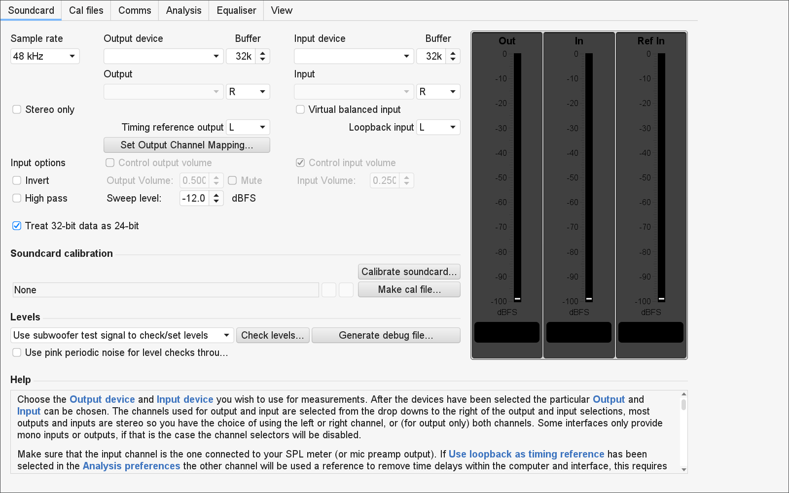

# 交付说明 · REW 鸿蒙 PC 运行时适配

日期：2026-11-18  
仓库：https://github.com/huihui200739/REW-HarmonyPC  
镜像：https://atomgit.com/2501_93573368/ohos_REW  
组织仓申请：[issue #464](https://atomgit.com/OpenHarmonyPCDeveloper/community/issues/464)

---

## 一、核心成果

**REW V5.31.3 的完整界面已在 HarmonyOS PC 上成功渲染。**



上图为 1600×1000 的渲染输出，包含：
顶部标签页（Soundcard / Cal files / Comms / Analysis / Equaliser / View）、
设备选择下拉框、三个电平表（Out / In / Ref In，−10 ~ −100 dBFS 刻度）、
完整的英文帮助文本。**界面与原版一致，未做任何重写。**

## 二、技术路径

| 层 | 内容 |
|---|---|
| JVM | OpenJDK 17（BiSheng 基线）交叉编译到 aarch64-linux-ohos |
| 类库 | java.base + java.desktop 等 12 个模块，jlink 出 73 MB runtime |
| 图形 | java.desktop 全量 native（awt / awt_headless / fontmanager / freetype / jawt / lcms / mlib_image / javajpeg） |
| 移植层 | `ohos.awt`（Toolkit / GraphicsEnvironment / Peers / CMM）+ SurfaceData side table |
| 宿主 | ArkTS HAP（JNI 启动 JVM、部署 runtime、离屏渲染） |

## 三、实测证据

| 能力 | 证据 |
|---|---|
| OpenJDK 17 在 OHOS 运行 | `java.version=17.0.17-internal`，libjvm.so 20 MB / AArch64 / 零 GLIBC |
| java.desktop 全量 native | 8 个 .so 全部产出并加载 |
| REW 主类加载 + main 执行 | `FrameCapture: main started; frames=3` |
| REW 界面构建 | `roomeqwizard.oI` 面板 44 个子组件、FlatLaf 组件已实例化 |
| **REW 界面完整渲染** | **1600×1000 PNG，131 KB（见上图）** |
| Java2D 管线 | 离屏绘制 + FreeType 字形 + ImageIO 编码全通 |
| 颜色管理 | 自建 sRGB ICC v2 profile + identity CMM |

## 四、两个关键修复（对其它 JVM/Java 图形移植有复用价值）

| 现象 | 根因 | 修复 |
|---|---|---|
| `ICC_ColorSpace.toRGB` 抛 `ArrayIndexOutOfBoundsException: Index 1 out of bounds for length 1` | 自建 CMM 的 `colorConvert(short[], short[])` 返回数组长度用 `src.length`（灰度=1），而 `toRGB` 读 `tmp[0..2]` | 返回数组按**输出分量数**分配，灰度值复制到 RGB 三通道 |
| `printAll(g)` 在离屏 Graphics 上什么都不画 | `printAll` 走 `Printable` 路径，要求 `PrintGraphics` | 改用 **`paint(g)`** |

## 五、其它移植要点

| 问题 | 解法 |
|---|---|
| OHOS linker 只在 `DT_NEEDED` 闭包内解析符号 | `patchelf --add-needed`（libjava→libjdkshim、libfontmanager→libawt_headless） |
| `java.awt.peer` 未导出，外部 jar 无法实现 ComponentFactory | 把 AWT 后端**下沉进 java.desktop** |
| `PlatformGraphicsInfo` 硬编码 X11 | 补丁改为读 `java.awt.graphicsenv` / `awt.toolkit` |
| `SurfaceData_SetOps` 读 `pData` 得到 0x1 | 改为 **native side table** |
| lcms 依赖缺失 | 自建 identity CMM + 完整 sRGB profile |
| 字体配置走 fontconfig 崩溃 | 强制 MFontConfiguration |

## 六、未完成（诚实记录）

| 项 | 原因 |
|---|---|
| 界面显示到屏幕 | ArkTS `Image` 组件三条路线（`file://` / `PixelMap` / 自动加载）均未出图；正确方案是 `XComponent` + `OH_NativeWindow`，未排期 |
| 输入事件 | 依赖上屏方案 |
| Java Sound | 需 OHAudio 后端，未开始（界面设备下拉框因此为空） |
| JIT | 仅 `-Xint` |
| 真机验证 | 仅模拟器（API 24 / arm64 / 2in1） |
| HAP 签名 | 缺证书密码 |

## 七、复现

```bash
jvm/fetch-jdk.sh && jvm/apply-jdk-patches.sh && jvm/configure-jdk.sh
jvm/build-jvm.sh --jobs 6
jvm/build-runtime.sh
scripts/verify.sh
```

然后构建 `app/`（DevEco Studio 或 hvigorw），安装到 API 24 / arm64 / 2in1 设备。

## 八、许可

- 适配层代码：Apache-2.0；
- 上游 REW：闭源免费软件，遵循其 EULA，**本仓库不分发 REW 二进制**。
