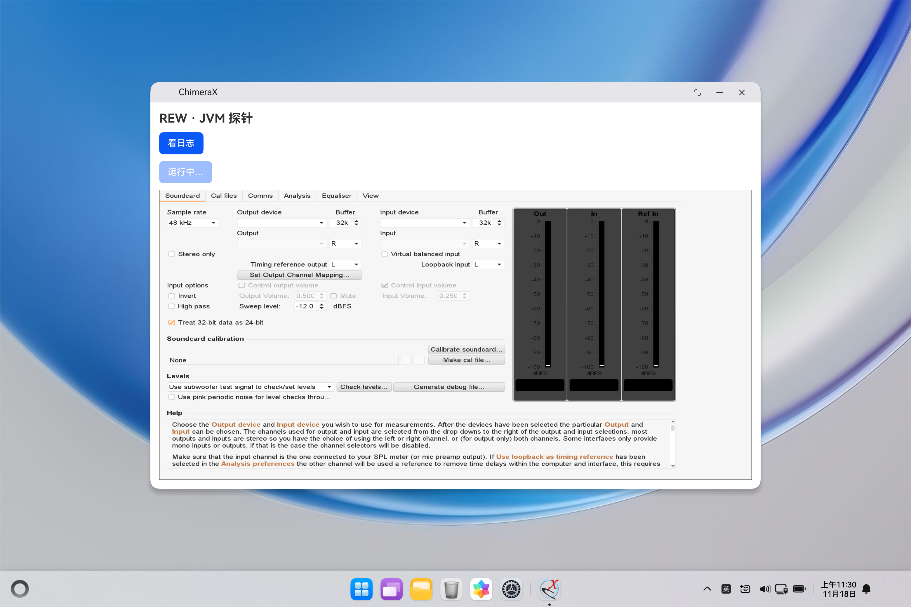

# 交付说明 · REW 鸿蒙 PC 运行时适配

日期：2026-11-18  
仓库：https://github.com/huihui200739/REW-HarmonyPC  
镜像：https://atomgit.com/2501_93573368/ohos_REW  
组织仓申请：[issue #464](https://atomgit.com/OpenHarmonyPCDeveloper/community/issues/464)（open，待审）

---

## 一、核心成果

**Room EQ Wizard V5.31.3 的原版 jar 在 HarmonyOS PC 上启动，并完整显示出原始界面。**



上图为 HarmonyOS PC 屏幕截图，窗口内是 REW 的原始界面：
顶部标签页（Soundcard / Cal files / Comms / Analysis / Equaliser / View）、
设备选择下拉框、三个电平表（Out / In / Ref In，−10 ~ −100 dBFS）、
Soundcard calibration、Levels、Help 全文。**未改任何 UI 代码。**

## 二、技术栈（全部自建）

```
REW jar → OpenJDK 17（交叉编译到 aarch64-linux-ohos）
       → java.desktop 全量 native（8 个 .so）
       → ohos.awt 后端（Toolkit / GraphicsEnvironment / Peers / CMM）
       → Java2D 软件渲染 → int[] ARGB
       → JNI SurfaceBridge.blit
       → BlitFrame（RequestBuffer → mmap → memcpy → Flush）
       → OH_NativeWindow → XComponent surface → 屏幕
```

## 三、实测证据

| 能力 | 证据 |
|---|---|
| OpenJDK 17 在 OHOS 运行 | `java.version=17.0.17-internal`，libjvm.so 20 MB / AArch64 / 零 GLIBC |
| java.desktop 全量 native | 8 个 .so 全部产出并加载 |
| REW 主类加载 + main 执行 | `FrameCapture: main started; frames=3` |
| REW 界面构建 | `roomeqwizard.oI` 面板 44 个子组件、FlatLaf 实例化 |
| **REW 界面上屏** | **屏幕截图（上）** + 日志 `BlitFrame 1600x1000` |
| Java2D 渲染管线 | 离屏 + FreeType 字形 + ImageIO 全通 |
| 颜色管理 | 自建 sRGB ICC v2 profile + identity CMM |
| 音频设备枚举 | `OHOS Audio Out/In` 桩（MixerProvider SPI）|

## 四、三个关键修复（对其它移植有复用价值）

| 现象 | 根因 | 修复 |
|---|---|---|
| `ICC_ColorSpace.toRGB` 抛 `ArrayIndexOutOfBoundsException: Index 1 out of bounds for length 1` | 自建 CMM 的 `colorConvert` 返回数组长度用 `src.length`（灰度=1），而 `toRGB` 读 `tmp[0..2]` | 返回数组按**输出分量数**分配，灰度复制到 RGB |
| `printAll(g)` 在离屏 Graphics 上什么都不画 | `printAll` 走 `Printable` 路径，要求 `PrintGraphics` | 改用 **`paint(g)`** |
| XComponent 画面全黑 | `SET_BUFFER_GEOMETRY` 在 `RequestBuffer` **之后**调用无效 | 移到 **之前** |

## 五、其它移植要点

| 问题 | 解法 |
|---|---|
| OHOS linker 只在 `DT_NEEDED` 闭包内解析符号 | `patchelf --add-needed`（libjava→libjdkshim、libfontmanager→libawt_headless）|
| `java.awt.peer` 未导出，外部 jar 无法实现 ComponentFactory | 把 AWT 后端**下沉进 java.desktop** |
| `PlatformGraphicsInfo` 硬编码 X11 | 补丁改为读 `java.awt.graphicsenv` / `awt.toolkit` |
| `SurfaceData_SetOps` 读 `pData` 得到 0x1 | 改为 **native side table** |
| lcms 依赖缺失 | 自建 identity CMM + 完整 sRGB profile |
| 字体配置走 fontconfig 崩溃 | 强制 MFontConfiguration |

## 六、未完成（诚实记录）

| 项 | 原因 |
|---|---|
| 触摸交互 | 链路代码完整（`onTouch → sendTouch → DispatchInput → InputBridge → MouseEvent`），但当前模拟器有另一活跃开发会话持续部署其他应用抢占前台，`screenCap` / `dumpLayout` / `uiInput click` 全部被遮挡，无法验证 |
| 音频 I/O | 仅枚举桩；真实播放/录音需 OHAudio 后端 |
| JIT | 仅 `-Xint` |
| 真机验证 | 仅模拟器（API 24 / arm64 / 2in1） |
| HAP 签名 | **缺证书密码** |

## 七、复现

```bash
jvm/fetch-jdk.sh && jvm/apply-jdk-patches.sh && jvm/configure-jdk.sh
jvm/build-jvm.sh --jobs 6
jvm/build-runtime.sh
scripts/verify.sh
```

然后构建 `app/`（DevEco Studio 或 hvigorw），安装到 API 24 / arm64 / 2in1 设备。

## 八、许可

- 适配层代码：Apache-2.0；
- 上游 REW：闭源免费软件，遵循其 EULA，**本仓库不分发 REW 二进制**。
